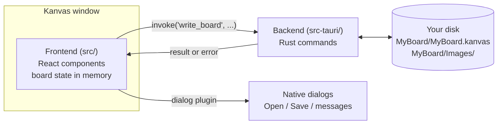
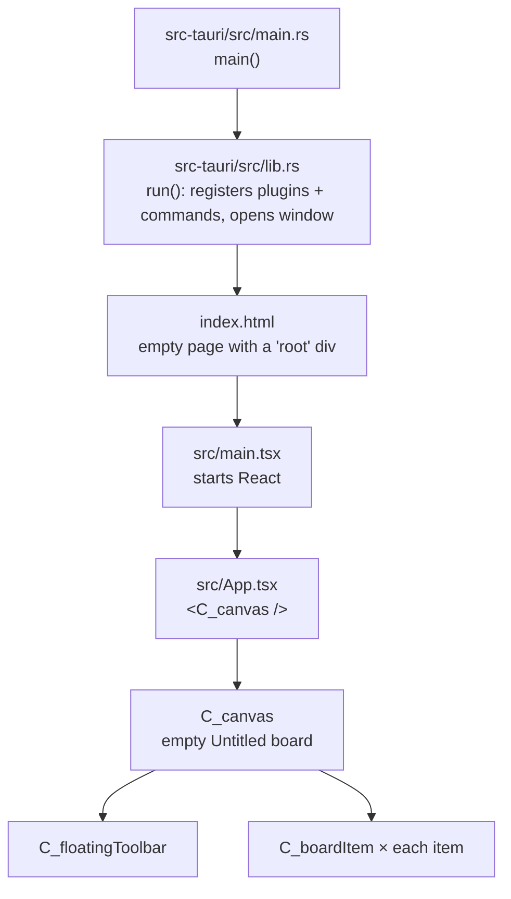
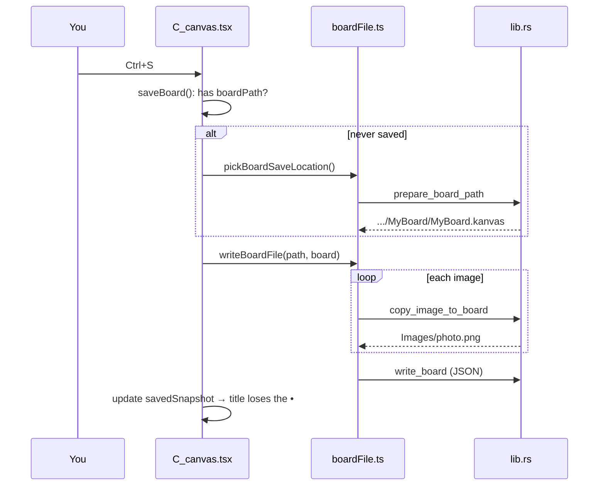

# Kanvas codebase guide

A map of the Kanvas code for someone who doesn't write TypeScript, React or Rust. It explains what each part does, where data lives, how the parts call each other, and where to start when adding a feature.

Related notes: [[APP design]] · [[AI output]] · [[MoodBoard]]

> [!info] Paths
> Paths like `src/components/C_canvas.tsx` are relative to the project folder `2604_Kanvas/`, one level above this vault. They are plain text here, not Obsidian links, because the code lives outside the vault.

---

## 1. The big picture

Kanvas is two programs packaged as one app:

| Half | Language | Lives in | Job |
|---|---|---|---|
| **Frontend** (what you see) | TypeScript + React + CSS | `src/` | Draws the canvas, toolbar, images and text boxes; handles the mouse and keyboard; keeps the board in memory. |
| **Backend** (the shell) | Rust | `src-tauri/` | Opens the window, and does what a web page isn't allowed to: read and write files, copy images, show native file dialogs. |

The frontend is a web page running inside a built-in browser engine (WebKitGTK on Linux, WebView2 on Windows, WebKit on macOS). **Tauri** is the framework that joins the two halves: the frontend asks the backend to do things with a function called `invoke(...)`.



> [!tip] Rule of thumb
> Visual or interaction change → `src/`. Anything that touches files or the operating system → `src-tauri/`, plus a small function in `src/lib/` that calls it.

---

## 2. Folder map

```
2604_Kanvas/
├── src/                          FRONTEND
│   ├── main.tsx                  Starts React and mounts the app into index.html
│   ├── App.tsx                   The outer shell; just renders the canvas
│   ├── App.css                   ALL styling: colours, themes, toolbar, items
│   ├── components/               Visual building blocks (React components)
│   │   ├── C_canvas.tsx          The brain: board state, mouse, keyboard, save/open
│   │   ├── C_boardItem.tsx       Draws ONE image or text box, with handles and option bar
│   │   ├── C_floatingToolbar.tsx The draggable toolbar, its buttons and the recent-boards menu
│   │   └── C_settingsDialog.tsx  The settings dialog (all its sections and controls)
│   └── lib/                      Logic with no visuals
│       ├── boardItems.ts         What an item is (types, text styles) + geometry maths
│       ├── boardFile.ts          Reading/writing .kanvas files, file dialogs
│       ├── settings.ts           App settings: what they are, defaults, load/save, colours
│       └── useSettings.ts        Loads settings at startup and auto-saves changes
│
├── src-tauri/                    BACKEND
│   ├── src/main.rs               Program entry point; just calls lib.rs
│   ├── src/lib.rs                Rust commands (file work) + app setup + tests
│   ├── Cargo.toml                Rust dependencies (like package.json, for Rust)
│   ├── tauri.conf.json           App name, window size, security, packaging
│   ├── capabilities/default.json Permissions: what the frontend may ask for
│   └── icons/                    App icons for each platform
│
├── index.html                    The single web page the frontend lives in
├── package.json                  Frontend dependencies + npm commands
├── README.md, docs/              Developer docs
└── MoodBoard App/                This Obsidian vault
```

**Folders you can ignore.** They are generated or downloaded, and are not in Git:

- `node_modules/`: downloaded JavaScript libraries (`npm install` recreates it).
- `dist/`: the built frontend (`npm run build` recreates it).
- `src-tauri/target/`: compiled Rust (huge; recreated on build).
- `src-tauri/gen/`: generated schemas.

---

## 3. Just enough of each language

### TypeScript (`.ts`, `.tsx`)
JavaScript with **types**: labels that say what shape data has, so mistakes are caught before running. For example, from `src/lib/boardItems.ts`:

```ts
export type BoardTextItem = Rect & {   // a text item is a rectangle (x, y, width, height)...
  id: string;                           // ...plus an id,
  type: "text";                         // ...a type tag,
  text: string;                         // ...and its text.
};
```

- `export` makes something usable from other files; `import { X } from "./file"` pulls it in.
- `const name = (a, b) => ...` is a function. `async` / `await` marks something that takes time (a file save, a dialog) and waits for it.
- `.tsx` files mix code with HTML-like tags. Those tags are React components.

### React
React builds the screen from **components**: functions that return what should be drawn. Four ideas cover almost all of this codebase:

| Idea | What it means | Example in Kanvas |
|---|---|---|
| **Component** | A function that returns UI. Used like a tag: `<C_boardItem ... />`. | `C_boardItem` draws one item. |
| **Props** | Inputs passed into a component, like function arguments. | `C_canvas` passes `item` and `isSelected` to each `C_boardItem`. |
| **State** (`useState`) | Data the component remembers. **Changing state redraws the screen.** | `const [items, setItems] = useState([])`: call `setItems(...)` and the board redraws. |
| **Effect** (`useEffect`) | Code that runs after drawing, often to attach listeners. | Keyboard shortcuts are attached in an effect in `C_canvas`. |

Data flows **down** through props (canvas → items). Events flow **up** through callback props: an item calls `onDelete(id)`, a function the canvas gave it, and the canvas updates its state.

You'll also see `useRef`, a box that holds a value **without** redrawing when it changes (used for fast-changing things like the current drag), and `useCallback` / `memo`, which are performance helpers so dragging one item doesn't redraw all the others.

### CSS (`App.css`)
Styling rules: `.class-name { property: value; }`. Colours for both themes are **variables** at the top of the file (`--panel-bg`, `--item-text`, …). Light mode overrides them in `.moodboard-canvas--light`. To change a colour, change the variable.

### Rust (`.rs`)
Only one file matters: `src-tauri/src/lib.rs`. The part you'll touch is **commands**, functions marked `#[tauri::command]` that the frontend can call:

```rust
#[tauri::command]
fn read_board(app: AppHandle, board_path: String) -> Result<String, String> {
    // returns Ok(file contents), or Err(error message) which the frontend receives as an error
}
```

Every command must also be **registered** in `run()` at the bottom, in `tauri::generate_handler![...]`. A command that isn't listed there can't be called.

> [!note] Naming across the bridge
> Rust uses `snake_case` (`board_path`), TypeScript uses `camelCase` (`boardPath`). Tauri converts automatically, so `invoke("read_board", { boardPath })` reaches `board_path`.

---

## 4. How the app starts



---

## 5. Each file, in plain words

### `src/components/C_canvas.tsx` (the brain, about 1,100 lines)
Owns everything about the current board. Read it top to bottom in this order:

1. **Constants**: `MIN_ZOOM`, `MAX_ZOOM`, `DRAG_THRESHOLD` (pixels before a press counts as a drag).
2. **`Interaction` type**: the four things the mouse can be doing: `pan`, `move`, `resize`, `marquee` (box-select).
3. **State**, the board's memory:
   - `items`: every image and text box. **List order = layer order** (last is on top).
   - `selectedIds`: which items are selected.
   - `settings`: the app settings (from `useSettings`), and `boardSettings`: this board's own theme override and background.
   - `activeTheme`: the theme actually shown, worked out from the board override, the app setting and the system theme.
   - `view`: pan position and zoom (`{ x, y, zoom }`).
   - `toolbarPosition`: where the toolbar sits.
   - `boardPath`: where the board is saved (`null` if never saved).
   - `savedSnapshot`: a copy of the board as last saved; comparing it with the current board gives `isDirty` (unsaved changes).
   - `historyRef`: the undo history. `past` and `future` are earlier and undone copies of `items` (up to 100). Panning, zooming and settings are not part of it.
4. **Undo and redo**: `recordUndoStep()` is called **just before** any change to `items` and saves the board as it was. A whole drag or resize is one step (recorded on mouse release); typing in one text box is one step until you click elsewhere. `undo` / `redo` swap copies between `past` and `future`. Opening or creating a board clears the history. **When you add a new way to change items, call `recordUndoStep()` first.**
5. **Adding things**: `handleImport` (pick images → add image items), `handleAddText`.
6. **Item callbacks** passed down to every item: `handleItemPointerDown` (select + start move), `handleResizeStart`, `handleItemContextMenu`, `handleItemDelete`, `handleTextChange`.
7. **Canvas mouse**: `handleCanvasPointerDown` (middle button = pan, left on empty space = box-select), `handleCanvasContextMenu` (right-click moves the toolbar to the cursor).
8. **The drag engine**: one effect listening to `pointermove` / `pointerup` for the whole window. It looks at the current `Interaction` and moves, resizes, pans or box-selects. Movement is divided by zoom so items stay under the cursor. Images resize with `resizeRectKeepingRatio`, so they always keep their shape; text boxes use `resizeRect`.
9. **Wheel zoom**: zooms around the mouse pointer, within the zoom limits from settings.
10. **File actions**: `applyBoard`, `writeBoardTo`, `saveBoard`, `saveBoardAs`, `resolveUnsavedChanges` (the Save / Don't Save / Cancel prompt), `newBoard`, `openBoard`, `runFileAction` (stops two dialogs from opening at once).
11. **Keyboard**: Delete/Backspace, Ctrl+Z / Ctrl+Shift+Z / Ctrl+Y (undo, redo), Ctrl+C / X / V, Ctrl+S, Ctrl+Shift+S, Ctrl+O, Ctrl+N, Ctrl+, (settings).
12. **Window**: the close-window prompt, and the window title (`• MyBoard — Kanvas` when unsaved).
13. **Startup**: once settings are loaded, puts the toolbar back where it was and (if enabled) reopens the last board.
14. **What it draws**: the dot grid, every `C_boardItem`, the selection box, the `FloatingToolbar`, and `C_settingsDialog` when open. The colours come from `getCanvasVariables` (in `settings.ts`) as CSS variables on the canvas.

### `src/components/C_boardItem.tsx` (one item)
Draws a single image or text box at its position: the frame, the picture or text, 8 resize handles (when selected), and the option bar beside it (delete; edit for text; crop is hidden until built). If an image file can't be loaded (deleted or renamed outside Kanvas), it shows an "Image missing" box with the file name instead. It **does not change data itself**. It calls the canvas's callbacks (`onDelete`, `onTextChange`, …). It remembers two things locally: `isEditing` (whether the text box is in typing mode) and `missingPath` (the image file that failed to load).

### `src/components/C_floatingToolbar.tsx` (the toolbar)
- `toolbarItems`: **the list of buttons**: label (tooltip), `type`, `disabled`, `dividerAfter`.
- `iconMap` inside `ToolbarIcon`: which icon each button type shows. Icons come from the **lucide** icon set (browse them at lucide.dev).
- `handleButtonClick`: maps each button type to the function the canvas passed in (`onSave`, `onImport`, …).
- It also handles dragging the toolbar by its handle.

### `src/lib/boardItems.ts` (what an item is)
Defines `BoardImageItem`, `BoardTextItem` and `BoardItem` (either one), the minimum sizes (`MIN_ITEM_SIZE`), `createItemId()`, and three maths helpers: `resizeRect` (resizing from an edge or corner), `resizeRectKeepingRatio` (the same, keeping the shape, used for images) and `rectsIntersect` (is an item inside the selection box?).

### `src/lib/boardFile.ts` (saving and loading)
- `writeBoardFile`: copies each image into the board's `Images/` folder (through Rust), then writes the `.kanvas` file.
- `readBoardFile`: reads a `.kanvas` file, turns relative image paths back into full paths, and upgrades old version-1 files.
- `pickBoardToOpen`, `pickBoardSaveLocation`, `pickImagesToImport`: the native file dialogs.
- `askAboutUnsavedChanges`, `showError`: native message boxes.
- `getBoardSnapshot`: what counts as a change. Panning and zooming don't.

### `src/lib/settings.ts` and `src/lib/useSettings.ts` (app settings)
- `Settings`: every app setting, grouped as `general`, `appearance`, `canvas`, `text`, plus `memory` (things the app remembers: last board, recent boards, toolbar position).
- `DEFAULT_SETTINGS` and `DEFAULT_COLORS`: the values on first launch.
- `loadSettings` / `saveSettings`: talk to Rust. Loading fills anything missing or invalid from the defaults, so an old or hand-edited `settings.json` can't break the app.
- `getCanvasVariables`: turns the colour scheme into the CSS variables `App.css` uses.
- `useSettings` (in `useSettings.ts`): loads once at startup and saves about half a second after the last change. `useSystemTheme`: follows the operating system's light/dark mode.

### `src/components/C_settingsDialog.tsx` (the settings dialog)
- `SECTIONS`: the list on the left. `renderSection` draws the chosen one.
- Small building blocks: `Row` (label + control, with an optional "This board" badge), `Segmented` (button group), `Toggle` (switch), `ComingSoon`.
- It never stores settings itself: every change goes through `onSettingsChange` (app settings) or `onBoardSettingsChange` (this board) to `C_canvas`.

### `src-tauri/src/lib.rs` (Rust commands)

| Command | Called from | What it does |
|---|---|---|
| `prepare_board_path` | `pickBoardSaveLocation` | Turns `~/Boards/MyBoard.kanvas` into `~/Boards/MyBoard/MyBoard.kanvas` and creates the folder plus `Images/`. |
| `read_board` | `readBoardFile` | Reads the `.kanvas` file; lets the window display that board's images. |
| `write_board` | `writeBoardFile` | Copies the previous save to `MyBoard.kanvas.bak`, then writes the `.kanvas` file safely (temp file first, then rename). |
| `copy_image_to_board` | `writeBoardFile`, `copyImageIntoBoard` | Copies an image into `Images/` with a unique name, unless it's already there. A missing file that was in `Images/` keeps its entry, so the board still saves. |
| `read_clipboard` | `readClipboard` | For Ctrl+V: reads copied image file paths (as text on Linux, as a file list from Explorer or Finder), or saves a copied image as a PNG. |
| `load_settings` / `save_settings` | `loadSettings` / `saveSettings` | Read and write `settings.json` in the app's config folder. |

At the bottom, `mod tests` holds automated tests (`cargo test` in `src-tauri/`).

### Config files

| File | What to change there |
|---|---|
| `src-tauri/tauri.conf.json` | App name, version, window size (now 800×600), packaging. `"targets": ["deb"]` means it only builds a Linux .deb package for now. |
| `src-tauri/capabilities/default.json` | Permissions. If a Tauri feature fails with "not allowed", its permission goes here. |
| `src-tauri/Cargo.toml` | Rust libraries. The Rust package is still called `the-moodboard` from the template, which is harmless: the installed program is named `kanvas` through `mainBinaryName` in `tauri.conf.json`. |
| `package.json` | Frontend libraries and the `npm run …` commands. |

---

## 6. Where data lives

| Data | While the app runs | On disk |
|---|---|---|
| Images, text boxes, positions, sizes, layer order | `items` state in `C_canvas` | `MyBoard.kanvas` → `items` |
| Image files | Original location until the board is saved | Copied into `MyBoard/Images/` on import (saved boards) or first save |
| This board's theme override and background | `boardSettings` state | `MyBoard.kanvas` → `settings` |
| Pan and zoom | `view` state | `MyBoard.kanvas` → `view` |
| App settings, recent boards, last board, toolbar position | `settings` (from `useSettings`) | `settings.json` in the app's config folder: `~/.config/com.krr.kanvas/` on Linux, `%APPDATA%\com.krr.kanvas\` on Windows, `~/Library/Application Support/com.krr.kanvas/` on macOS |
| Selection, undo history | State in `C_canvas` | **Not saved** |

A board on disk:

```
MyBoard/
├── MyBoard.kanvas
├── MyBoard.kanvas.bak     ← the previous save, written on every save
└── Images/
    ├── photo.png
    └── photo (2).png      ← same name from a different folder gets a number
```

Inside `MyBoard.kanvas` (plain JSON, so you can open it in a text editor):

```json
{
  "app": "kanvas",
  "version": 3,
  "settings": { "theme": "app", "background": "dots" },
  "view": { "x": 0, "y": 0, "zoom": 1 },
  "items": [
    { "id": "3f2a…", "type": "image", "name": "photo.png", "file": "Images/photo.png",
      "x": 64, "y": 64, "width": 220, "height": 147 },
    { "id": "9c1b…", "type": "text", "text": "New text box",
      "x": 180, "y": 110, "width": 220, "height": 110,
      "style": { "font": "sans", "size": 16, "color": null, "align": "center" } }
  ]
}
```

Image paths are **relative** (`Images/photo.png`), so the board folder can be moved or copied anywhere.

---

## 7. How things get called: four walkthroughs

### Dragging an image
1. Mouse press on an image → `C_boardItem` calls `onPointerDown` → `handleItemPointerDown` in `C_canvas`.
2. It updates `selectedIds` and records a `move` interaction (start position of every selected item).
3. Each mouse move → the drag engine computes the distance ÷ zoom and calls `setItems(...)` with new positions.
4. React redraws only the items that moved.
5. Mouse release → if anything moved, the board as it was before the drag becomes one undo step; the interaction is cleared.

### Saving (Ctrl+S)



### Opening a board
Toolbar **Open** → `openBoard` → `pickBoardToOpen` (dialog) → `resolveUnsavedChanges` (asks if needed) → `readBoardFile` → Rust `read_board` → `applyBoard` replaces all state.

### Closing the window
Tauri fires a close request → the listener in `C_canvas` calls `resolveUnsavedChanges` → if you pick Cancel, the close is stopped.

---

## 8. Adding features: where to start

### Recipe A: a new toolbar button
1. `C_floatingToolbar.tsx`: add the type to `ToolbarAction["type"]`, an entry in `toolbarItems`, an icon in `iconMap`, a prop (e.g. `onExport`) and an entry in `handleButtonClick`'s `actions`.
2. `C_canvas.tsx`: write the function and pass it to `<FloatingToolbar onExport={...} />`.

### Recipe B: something that needs the disk or the operating system
1. `src-tauri/src/lib.rs`: write a `#[tauri::command]` function and add it to `generate_handler![...]`.
2. `src/lib/…ts`: a small wrapper that calls `invoke("your_command", { ... })`.
3. If it uses a Tauri plugin or window feature, add its permission to `capabilities/default.json`.

### Recipe C: a new kind of board item (e.g. a link or a colour swatch)
1. `boardItems.ts`: add a type (e.g. `BoardLinkItem`), add it to `BoardItem`, and add a `MIN_ITEM_SIZE` entry.
2. `C_boardItem.tsx`: draw it.
3. `boardFile.ts`: only needed if it references files (like images do).
4. `C_canvas.tsx`: a `handleAdd…` function and a toolbar button (Recipe A).

### Recipe D: a new setting
The settings dialog is built (see [[Settings Panel]]). To add one more setting, for example "zoom speed":

1. **`src/lib/settings.ts`**: add the field to the `Settings` type (in the right group, e.g. `canvas.zoomSpeed`), and a default to `DEFAULT_SETTINGS`. If it has a limited range or a fixed set of values, add a line to `sanitize` so bad values fall back to the default. Existing `settings.json` files pick up the default automatically.
2. **`src/components/C_settingsDialog.tsx`**: add a `<Row>` with a control in the right section of `renderSection`. Use `update("canvas", { zoomSpeed: … })` to change it.
3. **Use it** where the behaviour lives, usually `C_canvas.tsx`, reading `settings.canvas.zoomSpeed`. Code inside listeners that are set up only once (wheel, mouse moves, keyboard) must read `settingsRef.current` instead, to get the latest value.
4. **Board setting instead?** Add it to `BoardSettings` and `DEFAULT_BOARD_SETTINGS` in `boardFile.ts`, read it in `readBoardFile`, and pass `isBoardSetting` to its `<Row>` so it shows the "This board" badge. Board settings are saved in the `.kanvas` file and mark the board unsaved when changed.

---

## 9. Running and checking

| Command (run in the project folder) | What it does |
|---|---|
| `npm install` | Downloads frontend libraries (first time, or after `package.json` changes). |
| `npm run tauri dev` | **Runs the app** for development. Saving a `src/` file updates the window instantly; Rust changes trigger a rebuild. |
| `npm run tauri build` | Builds an installable app package. |
| `npm run build` | Checks types and builds only the frontend: a quick "does it compile" test. |
| `cargo test` (inside `src-tauri/`) | Runs the Rust tests. |

> [!tip] Seeing errors
> Frontend errors appear in the app's developer tools. In dev mode, press **Ctrl+Shift+I** (Cmd+Option+I on macOS) and open the **Console** tab. Right-click won't work for this, because Kanvas uses right-click to move the toolbar. Rust errors and `println!` output appear in the terminal running `npm run tauri dev`.

---

## 10. Glossary

| Term | Meaning |
|---|---|
| **Component** | A React function that draws part of the screen. Files start with `C_`. |
| **Props** | Inputs passed to a component. |
| **State** | Data a component remembers; changing it redraws the screen. |
| **Callback** | A function handed to another part of the code so it can report back (`onDelete`). |
| **invoke** | How the frontend calls a Rust command. |
| **Command** | A Rust function the frontend may call (`#[tauri::command]`). |
| **Capability / permission** | Tauri's allow-list of what the frontend may do. |
| **Asset protocol** | How the window displays image files from disk (`convertFileSrc`). |
| **Plugin** | Ready-made Tauri feature; Kanvas uses `dialog` (file and message dialogs) and `opener`. |
| **Snapshot / dirty** | Snapshot = the board as last saved; dirty = the current board differs from it. |
| **Marquee** | The drag-to-select rectangle. |
| **Board space vs screen space** | Positions on the infinite board vs pixels in the window; zoom and pan convert between them. |
