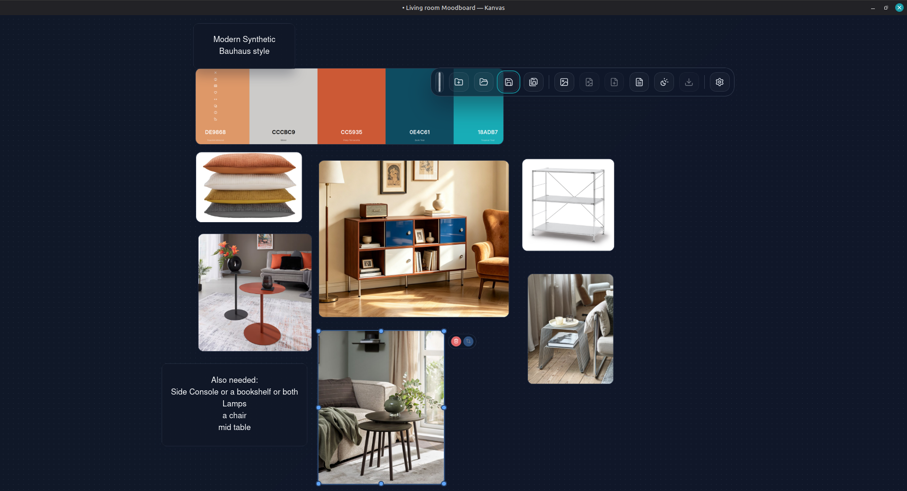

# Kanvas

**A free, simple mood board app for your desktop.** Collect images and notes on an endless canvas, arrange them freely, and keep every board as a plain folder on your own computer. No account, no cloud.



> [!NOTE]
> **Kanvas is a vibe-coded app.** It was designed, directed and tested by a person. The code was written by AI coding assistants (GitHub Copilot, then Claude). It's free to download and use. It's a beta, so expect some rough edges.

## What you can do

- Import images and add text notes.
- Move, resize and select several items at once; pan and zoom around the board.
- Save each board as a folder: a `.kanvas` file plus copies of its images, so nothing breaks if the originals move.
- Pick a dark, light or system theme, and customise colours, the grid, the toolbar and text defaults.
- Reopen recent boards from the toolbar.

## Download

**Linux (Debian, Ubuntu and similar, 64-bit):** [Kanvas_0.9.0_amd64.deb](https://github.com/KhaledAlmanla/Kanvas/releases/download/v0.9.0/Kanvas_0.9.0_amd64.deb)

```bash
sudo apt install ./Kanvas_0.9.0_amd64.deb   # install; Kanvas appears in your app menu under Graphics
sudo apt remove kanvas                      # uninstall
```

Windows and macOS versions are planned for 1.0. See all [releases](https://github.com/KhaledAlmanla/Kanvas/releases).

## Status

**Current: 0.9.0 (beta).** **Next: 1.0:** undo/redo, copy/paste and drag-and-drop for images, no unfinished toolbar buttons, and Windows and macOS builds.

- [Changelog](MoodBoard%20App/CHANGELOG.md): what changed in each version
- [Roadmap](MoodBoard%20App/Roadmap.md): what's planned

## Build it yourself

Kanvas is built with [Tauri 2](https://tauri.app) (Rust) and React with TypeScript. You need Node.js, Rust and the [Tauri prerequisites](https://tauri.app/start/prerequisites/) for your system.

```bash
npm install
npm run tauri dev     # run the app while developing
npm run tauri build   # build an installable package
```

New to the code? The [Codebase Guide](MoodBoard%20App/Codebase%20Guide.md) explains how it's organised, in plain language.
